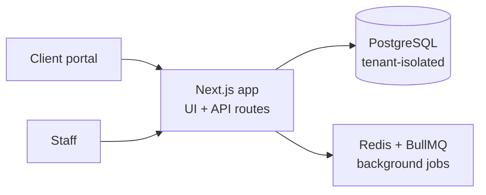

# Multi-tenant ERP for HVAC Services (Kateka Clima): Case Study

> Multi-tenant ERP I designed and built for **Kateka Clima**, an HVAC installation and maintenance company.
> **Source code is private.** This repository documents the project; a live walkthrough is available on request.

## What it covers

- **Sales**: quotes and orders.
- **HVAC maintenance plans**: recurring service contracts and scheduling.
- **Finance**, **HR** and **inventory**.
- **Client portal**: customers follow their services and plans online.
- **Multi-tenant**: one platform serving multiple companies with isolated data.

## Architecture

- Next.js full stack with Prisma and PostgreSQL; background jobs (reminders, recurring maintenance, notifications) on Redis/BullMQ.

## My role

Architecture, data modeling, full stack development and deployment.

---
Built by **Victor Sestrem** · [LinkedIn](https://www.linkedin.com/in/victor-sestrem/) · victor-sestrem@hotmail.com
